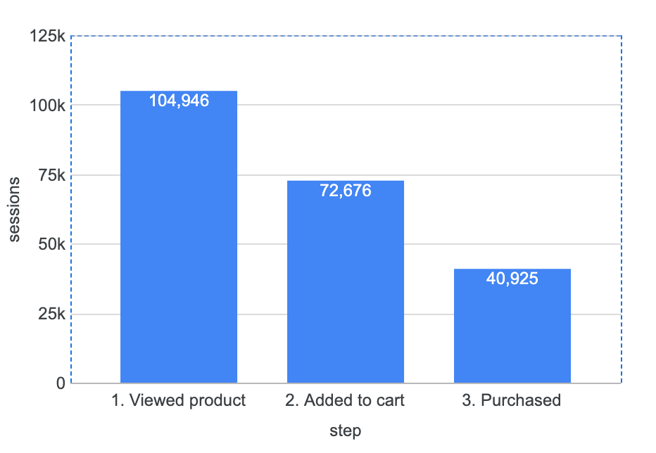
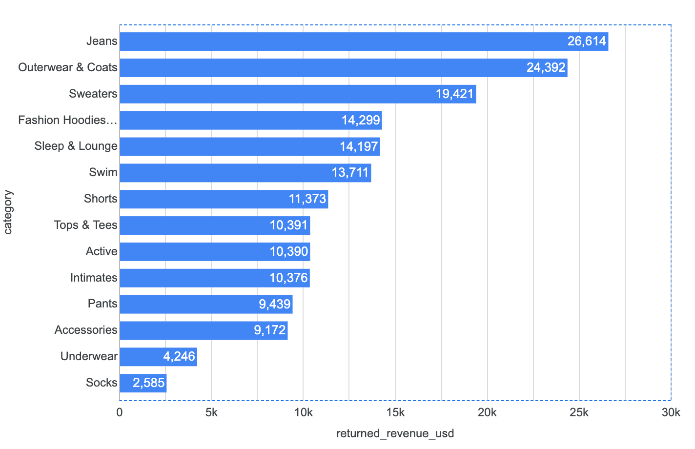
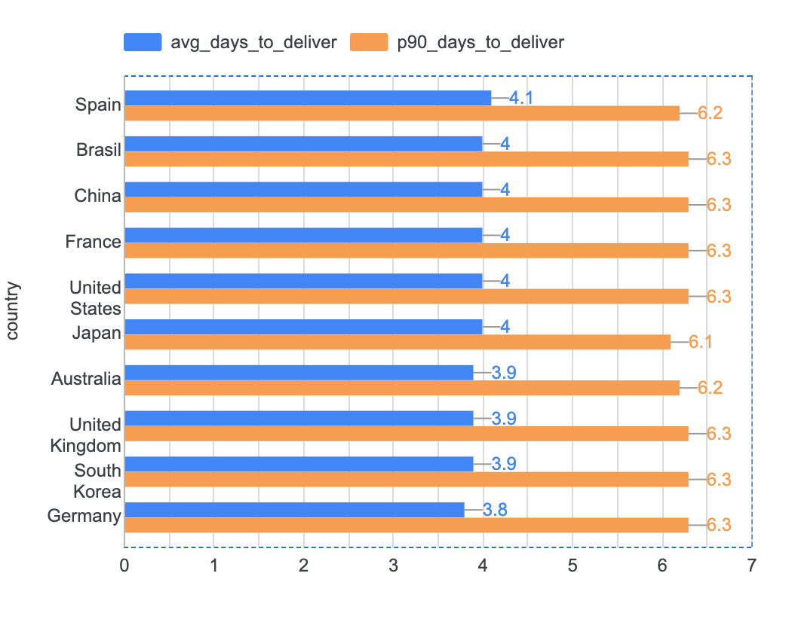

# E-commerce Funnel and Operations Analysis

An analysis of a year of e-commerce data to find where the business loses customers and money, and what to fix first.

**Tools:** SQL, Google BigQuery, Data Studio (formerly Looker Studio)
**Data:** [`thelook_ecommerce`](https://console.cloud.google.com/marketplace/product/bigquery-public-data/thelook-ecommerce), a public BigQuery dataset for a fictional online clothing store. All figures cover sessions and orders from calendar year 2025, from a run on 29 Oct 2026.

---

## Business questions

1. Where do customers drop off between viewing a product, adding it to the cart, and buying? Does it differ by traffic source?
2. Which product categories have the highest return rates, and how much revenue do returns cost?
3. How long does delivery take in each country, and where is it slowest?

## Approach

- **Funnel (queries 01 and 02):** Grouped about 105,000 sessions and flagged whether each one viewed a product, added to cart, and purchased. The funnel is strictly nested: a session counts at a step only if it also completed every earlier step. This keeps conversion rates honest.
- **Returns (query 03):** Counted only items that reached the customer (completed or returned), so cancelled and in-transit orders do not lower the return rate. Measured returns both as a rate and in dollars.
- **Delivery (query 04):** Measured the average and the 90th percentile (p90) of days from order to delivery. The p90 shows the slow experience that an average hides.
- **Data quality:** Query 01 includes a check for purchases that skipped a funnel step. In testing it found fewer than 100 (under 0.1% of sessions), almost certainly sessions that began on 31 Dec 2024 and were cut by the date filter. Too small to affect results.
- **Stability check:** The dataset is regenerated regularly, so I ran every query on two different days and compared results. Findings that held on both days are treated as real; rankings that reshuffled are treated as noise.

## Key findings

### 1. Checkout is the biggest leak in the funnel

| Step | Sessions | Conversion from previous step |
|---|---|---|
| Viewed a product | 104,946 | |
| Added to cart | 72,676 | 69.3% |
| Purchased | 40,925 | **56.3%** |

31% of shoppers leave between viewing and adding to cart, but **44% abandon a full cart**. Checkout is where the most intent is lost.



### 2. The leak is site-wide, not a traffic quality problem

| Traffic source | Share of sessions | Session conversion |
|---|---|---|
| Organic | 5.0% | 40.0% |
| YouTube | 9.9% | 39.1% |
| Email | 45.0% | 39.1% |
| Adwords | 30.0% | 38.7% |
| Facebook | 10.1% | 38.6% |

Every channel converts within 1.4 percentage points of the others. That gap is within the margin of error (about plus or minus 1.3 points for Organic, the smallest channel), and the order changed between runs: Organic was the lowest converter on the first run and the highest on the second. Channels differ in how many visitors they send, not in how well those visitors convert. Email and Adwords bring three quarters of all traffic.

### 3. Returns cost $181K, and three categories drive 39% of it

28.5% of delivered items were returned (3,244 of 11,383), worth **$180,606** in revenue.

Ranking by return rate and ranking by dollars lost give very different answers:

| Category | Return rate | Returned revenue | Share of all returned revenue |
|---|---|---|---|
| Jeans | 28.3% | $26,614 | 14.7% |
| Outerwear & Coats | 28.9% | $24,392 | 13.5% |
| Sweaters | 29.5% | $19,421 | 10.8% |
| Underwear | 25.9% | $4,246 | 2.4% |
| Socks | 27.5% | $2,585 | 1.4% |

Every category returns between 26% and 30% of items. The difference in cost comes from price: a returned coat is worth about $130 and a pair of jeans about $92, against about $29 for underwear.

The return rate ranking is not reliable. Each category has only 500 to 1,100 delivered items, so each rate carries a margin of error of about plus or minus 3 points, and the ranking reshuffled completely between runs (Active went from the highest return rate, 32.3%, to one of the lowest, 26.1%). The dollar ranking held: Jeans, Outerwear & Coats and Sweaters were the top three on both days.



### 4. Delivery speed is consistent across markets

Across the 10 countries with at least 200 orders, average delivery is 3.8 to 4.1 days, and 90% of orders arrive within 6.1 to 6.3 days. No country stands out, and the slowest country changed between runs (Japan, then Spain). The real gap is within every market: most orders arrive in about 4 days, but **1 in 10 takes more than 6**.



## Recommendations

1. **Fix checkout before buying more traffic.** With 44% of carts abandoned on every channel, the highest-return work is on the checkout itself: test guest checkout, show shipping costs earlier, and cut form fields. Each point of cart-to-purchase improvement is worth roughly 730 extra orders a year at current volume.
2. **Target returns by dollars, not by rate.** Start with Jeans and Outerwear & Coats: add detailed size guides, fit notes from reviews, and more product photos. These two categories alone account for more than a quarter of returned revenue.
3. **Decide channel budgets on cost, not conversion.** Since every channel converts the same, the cheapest cost per session should win spend. This dataset has no marketing cost data, so that is the next analysis to run.
4. **Work on the slowest 10% of deliveries.** Find what those orders have in common (warehouse, product type, order day) rather than treating any country as the problem.

## Limitations

- `thelook_ecommerce` is synthetic. Its conversion rate (39% of sessions) is far above real e-commerce, which is typically in the low single digits, and the even spread across channels and countries likely reflects how the data was generated. The conclusions focus on comparisons and method, not on absolute numbers.
- No cost data (marketing spend, shipping costs, return processing), so the dollar impact covers lost revenue only.
- Categories with fewer than 500 delivered items and countries with fewer than 200 orders were excluded to avoid conclusions from small samples.

## Repository structure

```
ecommerce-funnel-analysis/
├── README.md
├── queries/
│   ├── 01_session_funnel.sql
│   ├── 02_funnel_by_traffic_source.sql
│   ├── 03_returns_by_category.sql
│   └── 04_delivery_time_by_country.sql
└── images/
    ├── funnel.png
    ├── returns_by_category.png
    └── delivery_by_country.png
```

## How to reproduce

1. Open the [BigQuery sandbox](https://console.cloud.google.com/bigquery) (free, no credit card needed).
2. Paste any file from `queries/` into the editor and click **Run**.

Expect small differences from the figures above, because the dataset is regenerated regularly. The findings above are the ones that held across runs.
